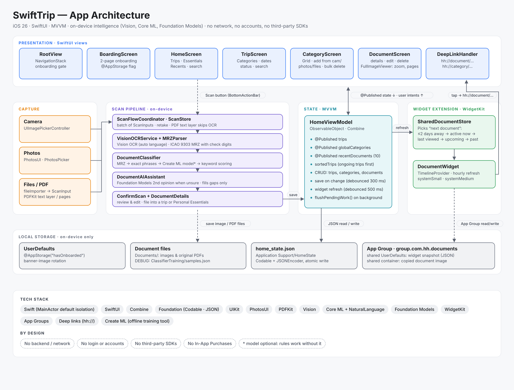

# SwiftTrip

**All your travel documents in one place: organized by trip, read automatically, and available offline.**

SwiftTrip is an iOS app for travellers whose boarding passes, hotel bookings, tickets and passports are scattered across email, screenshots, PDFs and chat apps. Scan or import a document once. SwiftTrip reads it on the device, works out what kind of document it is, pulls out the key details, and files it under the right trip. When you need it at the airport, a border crossing or check-in, it's one tap away, even from the Home Screen widget.

Everything runs **on the device**. There is no account, no server and no third-party SDK, and your documents never leave your iPhone.

---

## Features

| | Feature | What it does |
|---|---|---|
| 📷 | **Scan or import** | Take a photo, pick from Photos, or import images and **PDFs** from Files. Digital PDFs (e-tickets, booking confirmations) are read from their text layer. Scanned PDFs are OCR'd page by page. |
| 🧠 | **Smart categories** | Each document is classified into one of 10 types (passport, national ID, visa, boarding pass, train, hotel, reservation, activity, event, other). The classifier combines passport **MRZ** parsing, exact-phrase rules, an optional **Create ML** model and keyword scoring. On Apple Intelligence devices, **Foundation Models** gives a second opinion when the rules are unsure. |
| ✍️ | **Auto-filled details** | Name, document number, dates, booking code / PNR, flight, seat, route and hotel name are extracted and can be reviewed and edited before saving. |
| 🧳 | **Trip-based organization** | Documents are grouped under trips with preset categories (Flight, Hotel, Trains, Reservations, Activities, Events, Others). Trips are labelled *Upcoming*, *Ongoing* or *Completed* and sorted with the most relevant first. |
| 🪪 | **Personal Essentials** | Passport, ID and visa live outside any single trip, so they are always at hand. |
| 📌 | **Home Screen widget** | Shows the document you most likely need next: one starting within 2 days, then one active now, the last viewed, the next upcoming, and so on. Tap it to open the document. |
| 🔍 | **Find fast** | Search, *Recently viewed*, a full-screen viewer with pinch and double-tap zoom, and swiping through PDF pages. |
| 🗂️ | **Manage** | Edit details and notes, change trip dates, add or remove categories, and multi-select delete. |
| 🔒 | **Private & offline** | No network access at all. App Privacy label: **Data Not Collected**. |

---

## Architecture



SwiftTrip uses **MVVM** with SwiftUI:

- **Views:** SwiftUI screens that render state and forward user actions.
- **`HomeViewModel`:** the single source of truth for trips, categories and recent documents. Saves and widget refreshes are debounced.
- **Scan pipeline:** `ScanInput` → `VisionOCRService` + `MRZParser` → `DocumentClassifier` → `DocumentAIAssistant` → confirm and save.
- **Local storage:** a Codable JSON file for app state, plus image and PDF files in the app's Documents folder.
- **Widget extension:** reads a snapshot the app writes to a shared **App Group**, and links back into the app with `hh://` deep links.

**Why this design?** Travel IDs are sensitive and connectivity at airports is unreliable, so everything is processed on the device. A single view model keeps every screen and the widget consistent. Plain JSON fits the small, personal data set better than a database or a backend.

➡️ Full details: **[docs/ARCHITECTURE.md](docs/ARCHITECTURE.md)**

---

## Tech stack

| Area | Technology |
|---|---|
| Language & UI | Swift (MainActor default isolation, approachable concurrency), SwiftUI, Combine, UIKit (camera, zoom viewer) |
| Text recognition | Vision (`VNRecognizeTextRequest`, automatic language detection), PDFKit text layer |
| Document intelligence | MRZ parser (ICAO 9303), rules and keyword scoring, Core ML + NaturalLanguage (`NLModel`), Foundation Models (`@Generable`) |
| Persistence | Foundation `Codable` → JSON, `FileManager`, `UserDefaults` / `@AppStorage` |
| Widget | WidgetKit, App Groups, custom URL scheme deep links |
| Import | PhotosUI (`PhotosPicker`), `fileImporter`, UniformTypeIdentifiers |
| Tooling | Create ML training script (`Tools/DocumentClassifierTraining`) |

There are no external dependencies: no Swift packages, CocoaPods or third-party SDKs.

---

## Requirements

| | |
|---|---|
| Xcode | **26** or later |
| iOS (app) | **26.0+**, iPhone only |
| iOS (widget extension) | 18.6+ |
| Optional | An Apple Intelligence-capable iPhone for the Foundation Models second opinion. Everything else works without it. |

## Getting started

```bash
git clone https://github.com/Theona77/SwiftTrip.git
cd SwiftTrip
open SwiftTrip.xcodeproj
```

1. Select the **SwiftTrip** scheme and an iPhone simulator or device.
2. Under **Signing & Capabilities**, choose your team for both targets (**SwiftTrip** and **SwiftTripWidgetExtension**). If you change bundle IDs, also update the App Group (`group.com.hh.documents`) in both targets.
3. Build and run (**⌘R**). The first launch shows onboarding and two sample trips (Japan, Korea).

The camera needs a real device. In the simulator, import from Photos or Files instead.

➡️ Build settings, debugging, deep links and the classifier workflow: **[docs/DEVELOPMENT.md](docs/DEVELOPMENT.md)**

---

## Project structure

```
SwiftTrip/
├── SwiftTrip/                    # App target (synchronized folder)
│   ├── hhApp.swift               # @main entry point, injects view models
│   ├── DeepLinkHandler.swift     # hh://document/… and hh://category/… routing
│   ├── Models/                   # TripModel, CategoryModel, DocumentModel, HomeViewModel, ScanStore, ScanInput
│   ├── Service/                  # VisionOCRService, MRZParser, DocumentClassifier,
│   │                             # DocumentTextClassifier, DocumentAIAssistant,
│   │                             # PDFPageRenderer, TrainingSampleRecorder
│   ├── Screen/                   # Home, Trip, Category, Document, onboarding, scan confirmation
│   ├── ScreenController/         # RootView (navigation), ScanFlowCoordinator, routing helpers
│   ├── BottomTab/                # Scan button and source picker, ScanFlowLauncher
│   ├── View/                     # Reusable views: trip card, create sheets, zoomable viewer
│   ├── Extension/                # Small helpers (image storage, factories)
│   └── PrivacyInfo.xcprivacy     # Privacy manifest (app)
├── SwiftTripWidget/              # Widget extension target
│   └── Widget/                   # DocumentWidget, SharedDocumentStore (also compiled into the app)
├── Tools/DocumentClassifierTraining/   # Create ML training script + sample data
├── docs/                         # Architecture, development, App Store and privacy docs
└── AppReview/                    # App Review correspondence and resubmission checklist
```

---

## Documentation

| Document | Contents |
|---|---|
| [docs/ARCHITECTURE.md](docs/ARCHITECTURE.md) | Layers, scan pipeline, classification, data model, persistence, widget, deep links, design decisions |
| [docs/DEVELOPMENT.md](docs/DEVELOPMENT.md) | Targets and settings, running and debugging, testing deep links and the widget, conventions, known cleanup |
| [Tools/DocumentClassifierTraining/README.md](Tools/DocumentClassifierTraining/README.md) | Collecting samples and training and shipping the Create ML model |
| [docs/AppStoreSubmission.md](docs/AppStoreSubmission.md) | App Privacy and Accessibility answers for App Store Connect |
| [docs/privacy-policy.md](docs/privacy-policy.md) | Public privacy policy |
| [AppReview/Guideline-2.1-Response.md](AppReview/Guideline-2.1-Response.md) | App Review information and resubmission checklist |

---

## Privacy

SwiftTrip makes **no network requests**. Scanning, OCR, classification and the optional Apple Intelligence step all run on the iPhone. Data is stored in the app's private container. The widget gets one preview image and a small snapshot through the App Group. See the [privacy policy](docs/privacy-policy.md).

## Roadmap

- Ship a trained `DocumentTypeClassifier.mlmodel` built from real samples
- Optional iCloud sync and Face ID lock for sensitive documents
- Unit tests for `MRZParser`, `DocumentClassifier` and OCR field parsing
- Live Activity or reminders before departure

## Author

**Theona Arlinton**. Design, development and App Store release.
