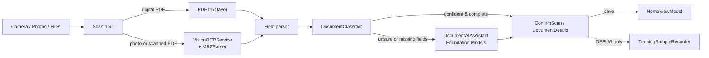
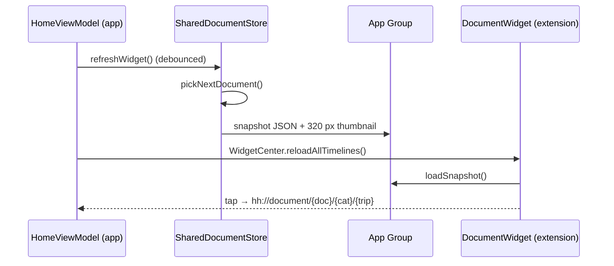

# SwiftTrip Architecture

This document explains how SwiftTrip is built and why. For setup and day-to-day development, see [DEVELOPMENT.md](DEVELOPMENT.md).


---

## 1. Overview

SwiftTrip is a **SwiftUI app with an MVVM structure** and a **WidgetKit extension**. It has no backend: every feature, including text recognition and document classification, runs on the iPhone.

| Layer | Responsibility | Main types |
|---|---|---|
| **Presentation** | SwiftUI screens and navigation | `RootView`, `HomeScreen`, `TripScreen`, `CategoryScreen`, `DocumentScreen`, `FullImageViewer` |
| **State (ViewModel)** | Single source of truth; all edits go through it | `HomeViewModel` |
| **Scan pipeline** | Capture or import → read → classify → confirm | `ScanFlowCoordinator`, `ScanStore`, `ScanInput`, `VisionOCRService`, `MRZParser`, `DocumentClassifier`, `DocumentTextClassifier`, `DocumentAIAssistant` |
| **Persistence** | Local files only | `home_state.json`, `Documents/` images and PDFs, `UserDefaults` |
| **Widget** | "Next document" on the Home Screen | `SharedDocumentStore`, `DocumentWidget` |
| **Routing** | Widget taps → screens | `DeepLinkHandler`, `RootView` navigation path |

---

## 2. Presentation layer

- **`hhApp`** is the `@main` entry point. It creates `HomeViewModel` and `DeepLinkHandler` once and injects them as environment objects. It forwards `onOpenURL` to the deep-link handler and calls `flushPendingWork()` when the app leaves the foreground.
- **`RootView`** shows `BoardingScreen` until `@AppStorage("hasOnboarded")` is set. After that it hosts a `NavigationStack` with a typed path (`AppDestination.category` / `.document`), so deep links can push screens.
- **Screens:**
  - `HomeScreen`: Personal Essentials, trips, Recently viewed, search.
  - `TripScreen`: categories, dates and status, search.
  - `CategoryScreen`: grid, add from camera, photos or files, multi-select delete.
  - `DocumentScreen`: details, edit, delete.
  - `FullImageViewer`: a UIKit `UIScrollView` wrapper with pinch (1×–5×) and double-tap zoom, and swiping through PDF pages.
- **Scan entry points:** the bottom bar (`BottomActionBar`) and category screens start the scan flow through `ScanFlowLauncher` and the `.scanFlow(_:)` view modifier.

Views hold only local UI state (sheets, selection, text fields). Data changes call `HomeViewModel` methods.

---

## 3. State: `HomeViewModel`

`HomeViewModel` is an `ObservableObject` and the **only owner of app data**:

| Property | Contents |
|---|---|
| `trips` | `[TripModel]`, each with its own `[CategoryModel]` |
| `globalCategories` | Personal Essentials: ID, Passport, VISA (not tied to a trip) |
| `recentDocuments` | The last 10 opened documents |
| `personalDocuments` | Older list, still saved so existing data keeps loading |
| `searchText` | Shared search query |

- `sortedTrips` orders trips as **ongoing → upcoming (soonest first) → past**.
- It provides CRUD for trips, categories (add, remove) and documents (add, update, delete everywhere a document appears).
- **Debounced side effects:**
  - Every `@Published` change calls `persistAppState()`, which writes JSON after **300 ms** of quiet.
  - `refreshWidget()` rebuilds the widget snapshot after **500 ms**.
  - `flushPendingWork()` runs both immediately when the app goes to the background, so nothing is lost on suspend.

**Why one view model?** The same document can appear on a trip, in Recently viewed and in the widget. With one owner, an edit or delete updates every place at once. The data is small enough that splitting it adds complexity without benefit.

---

## 4. Data model

```swift
struct TripModel: Codable      { id, name, startDate, endDate, description, imageName, isSaved, categories: [CategoryModel] }
struct CategoryModel: Codable  { id, name, icon, documents: [DocumentModel] }
struct DocumentModel: Codable  { id, name, imageName, note, startDate?, endDate?, categoryName, pdfFilename? }
```

- A trip's status (`isUpcoming`, `isOngoing`, `isCompleted`) is computed from its dates by calendar day.
- New trips get the default categories: Hotel, Flight, Trains, Reservations, Activities, Events, Others. They also get a banner (`img_banner1…12`), rotated so each one is used before any repeats.
- `DocumentModel.imageName` and `pdfFilename` are **file names** in the app's Documents folder. The model never holds image data, which keeps the JSON small.

---

## 5. Scan pipeline



### 5.1 Input: `ScanInput`
Each item entering the flow is a `ScanInput`:
- **Photo or image file:** downsampled for OCR.
- **PDF:** the first page becomes the preview, and the original bytes are kept so every page can be viewed later.
  - If the PDF has a usable **text layer** (30 characters or more), that text is used directly. This is exact and fast, and OCR is skipped.
  - Otherwise it's treated as a scanned PDF: up to **5 pages** are rendered and OCR'd as one document.

`ScanStore` holds the batch being reviewed. It supports several documents at once, retakes, and labels such as "Ticket 2 of 3". Every OCR run has a `runID`, so a late result from an earlier attempt never overwrites a retake.

### 5.2 Text recognition: `VisionOCRService`
- Uses `VNRecognizeTextRequest` at the `.accurate` level with **automatic language detection**, so Latin, CJK, Cyrillic, Arabic and Thai scripts all work.
- **Language correction is off.** Otherwise it "fixes" codes like PNRs, passport numbers and NIKs into dictionary words, for example turning 0 into O.
- Passes the EXIF orientation, so rotated photos are read correctly.
- `parse(lines:raw:)` pulls out labelled fields: name, document number, NIK, dates, booking code / PNR, ticket and order numbers, flight, seat, origin and destination, time, hotel and reservation number.

### 5.3 MRZ: `MRZParser`
Parses the ICAO 9303 machine-readable zone in the TD1 (3×30), TD2 / MRV-B (2×36) and TD3 / MRV-A (2×44) formats, and **verifies the check digits**. A valid MRZ is the most reliable signal OCR can provide, so its fields override anything else that was parsed.

### 5.4 Classification: `DocumentClassifier`
The classifier runs these steps in order and stops at the first confident answer:

| Step | Signal | Confidence |
|---|---|---|
| 1 | **MRZ** found → passport / visa / ID | 0.99 if the check digits are valid, otherwise 0.85 |
| 2 | **Unambiguous phrase** ("BOARDING PASS", "KARTU TANDA PENDUDUK"…). Boarding passes that mention trains are classified as train. | 0.95 |
| 3 | **Create ML text model** (`DocumentTextClassifier`, an `NLModel`). Used if the model is bundled and its confidence is at least 0.6, or if it agrees with the keyword result. | the model's probability |
| 4 | **Weighted whole-word keyword scoring** in several languages, plus points for structured fields (flight + seat, NIK, hotel name…). A score below 3 means "Others". | margin-based, ≤ 0.9 |

Step 3 is optional. Until `DocumentTypeClassifier.mlmodel` is added, steps 1, 2 and 4 handle everything. See [Tools/DocumentClassifierTraining/README.md](../Tools/DocumentClassifierTraining/README.md).

### 5.5 Second opinion: `DocumentAIAssistant`
On iOS 26 devices with Apple Intelligence, Apple's on-device **Foundation Models** language model is asked only when needed:
- **When:** the rules returned confidence below 0.6, returned "Others", or are missing key fields for the category (for example, a boarding pass with no flight number).
- **How:** it uses a `@Generable` schema (`GeneratedDocumentAnalysis`) with greedy sampling, a **10-second timeout**, and at most 2,500 characters of text.
- **Safeguards:**
  - A confident rule result is **never overridden**.
  - Model fields **only fill gaps**. A value is accepted only if every word of it appears in the OCR text, which guards against hallucination.
  - On any error, unsupported language, timeout, or a device without Apple Intelligence, the rule result is kept unchanged.

The rule result is shown immediately, and the model result updates the screen when it arrives. If the user has already changed the category by then, their choice is kept.

### 5.6 Confirm and save
`ConfirmScanScreen` and `DocumentDetailsScreen` let the user:
- check the category and extracted fields
- choose a trip and category, or Personal Essentials for passport, ID and visa
- save

Images and PDFs are written to `Documents/`, and the new `DocumentModel` is added through `HomeViewModel`.

In **DEBUG builds only**, `TrainingSampleRecorder` appends the normalised text, the confirmed category and the predicted category to `Documents/ClassifierTraining/samples.json`. This is training data for the Create ML model, and it never leaves the device.

---

## 6. Persistence

| What | Where | Format |
|---|---|---|
| Trips, categories, documents, recents | `Application Support/HomeState/home_state.json` | `Codable` → JSON, atomic write |
| Document images and original PDFs | `Documents/` | JPEG / PDF files referenced by name |
| Onboarding flag, banner rotation | `UserDefaults.standard` / `@AppStorage` | key–value |
| Widget snapshot and thumbnail | App Group `group.com.hh.documents` | `UserDefaults(suiteName:)` JSON plus a JPEG in the shared container |
| Classifier samples (DEBUG) | `Documents/ClassifierTraining/samples.json` | JSON array |

On first launch, when no JSON exists yet, the app seeds two sample trips (Japan and Korea) and the default Personal Essentials categories.

**Why JSON files, not Core Data, SwiftData or a server?** The data set is small, personal and stays on one device. A single Codable file is simple to reason about, easy to migrate and has no setup cost. Large binaries such as photos and PDFs are stored as separate files, so the JSON stays small.

---

## 7. Widget



- **`SharedDocumentStore`** is compiled into both targets. The app writes the snapshot, and the widget reads it.
- **Choosing the "next document"**, in priority order:
  1. a document starting within the next 2 days
  2. a document active right now
  3. the most recently viewed document
  4. the next upcoming document
  5. the most recently ended document
  6. any document
- **Thumbnail:** downsampled to 320 px without a full decode, saved under a new file name on each write so WidgetKit notices the change, with old copies deleted.
- **`DocumentWidget`** supports `systemSmall` and `systemMedium`, refreshes its timeline hourly, and shows as "SwiftTrip" in the widget gallery.

---

## 8. Deep links

URL scheme: **`hh://`**

| URL | Opens |
|---|---|
| `hh://document/{docId}/{categoryId}/{tripId}` | The document. The category is pushed first, so Back works naturally. |
| `hh://category/{categoryId}/{tripId}` | The category |

An empty `tripId` means a Personal Essentials category. `DeepLinkHandler` parses the URL into a `pendingDestination`, and `RootView` resolves the IDs against `HomeViewModel` and appends to the `NavigationStack` path.

---

## 9. Concurrency

- The app target uses **`SWIFT_DEFAULT_ACTOR_ISOLATION = MainActor`** and approachable concurrency, so UI and model code is on the main actor by default.
- Vision runs on a background queue and hops back to the main thread exactly once (`OnceFlag`), even if Vision both throws and calls its handler.
- Foundation Models calls are `async` and wrapped in a cancellable timeout task.
- Saves and widget refreshes are debounced with `Task.sleep`, and earlier pending tasks are cancelled.

---

## 10. Privacy by design

- The app makes **no network calls**: there is no `URLSession`, analytics, crash reporting, ads or Swift packages.
- OCR, MRZ parsing, classification and Foundation Models all run on the device.
- Privacy manifests in both targets declare no tracking and no collected data. They declare UserDefaults use with reasons **CA92.1** (the app's own settings) and **1C8F.1** (the App Group).
- The App Store App Privacy label is **"Data Not Collected"**. See [AppStoreSubmission.md](AppStoreSubmission.md).

---

## 11. Key design decisions

| Decision | Why |
|---|---|
| MVVM with one shared view model | Consistent data across screens and the widget; logic kept out of views |
| On-device OCR and AI | Passports and IDs are sensitive; works offline at airports; no API cost |
| Layered classifier (rules first, model optional, LLM last) | Fast and predictable; works on every device; the model and LLM add accuracy without being required |
| Hallucination guard on LLM output | Values must appear in the OCR text, so the model can't invent a booking code |
| PDF text layer before OCR | E-tickets have exact text; OCR would only add errors |
| JSON plus files instead of a database | Small personal data set; simple, transparent, no migration overhead |
| App Group plus deep links for the widget | Widgets run in a separate process; deep links make it one tap to the document |
| No third-party dependencies | Smaller app, no supply-chain risk, simpler privacy story and App Review |
