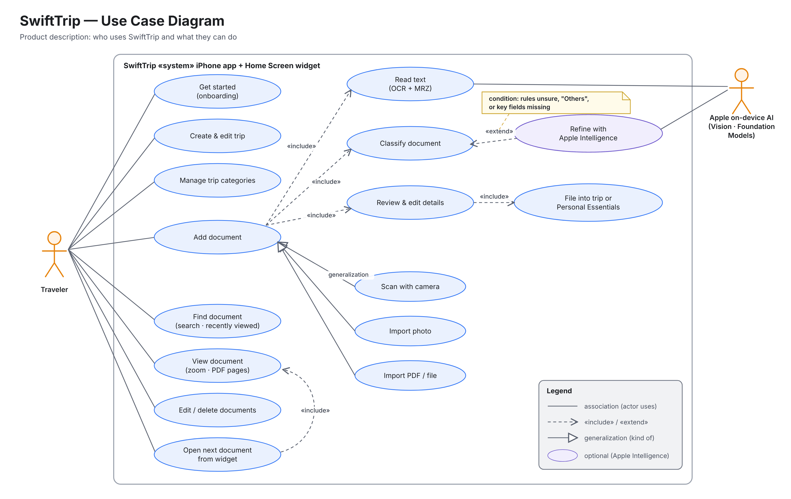
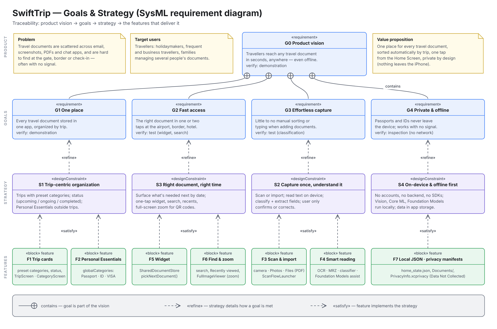
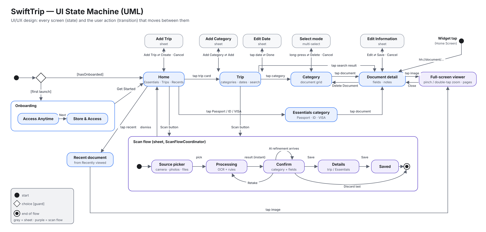
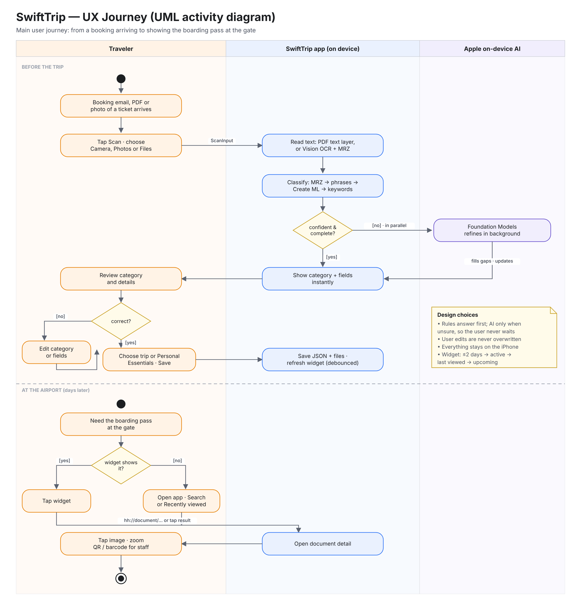

# SwiftTrip Product Design

The product side of SwiftTrip: what it is, who it's for, what it aims to achieve, how it gets there, and how the UI/UX is designed. Each part has a UML (or SysML) diagram. For the technical design, see [ARCHITECTURE.md](ARCHITECTURE.md) and [UML.md](UML.md).

| Topic | Diagram | Notation |
|---|---|---|
| [1. Product description](#1-product-description) | Use case diagram | UML |
| [2. Goals & strategy](#2-goals--strategy) | Requirement diagram | SysML (UML profile) |
| [3. UI/UX: navigation](#3-uiux-design) | State machine diagram | UML |
| [4. UI/UX: main journey](#4-uiux-main-user-journey) | Activity diagram with swimlanes | UML |

> UML has no dedicated "strategy" diagram. The standard way to model goals, strategy and their traceability to features is the **SysML requirement diagram**, an extension of UML. It's used here so every feature can be traced back to the goal it serves.

---

## 1. Product description

| | |
|---|---|
| **Problem** | Travel documents are scattered across email, screenshots, PDFs and chat apps. When they matter most (at the gate, a border crossing or hotel check-in) they're hard to find, often with no signal. |
| **Target users** | Travellers: holidaymakers, frequent and business travellers, and families who manage several people's documents. |
| **Value proposition** | One place for every travel document, sorted automatically by trip, one tap from the Home Screen, and private by design: nothing leaves the iPhone. |
| **Platform** | iPhone (iOS 26) plus a Home Screen widget. No account, no backend. |
| **Out of scope (v1)** | Booking travel, sharing documents with others, cloud sync, iPad/Mac. |



**Reading the use case diagram**
- **Traveler** is the only human actor. **Apple on-device AI** is a supporting system actor: Vision for text recognition, and Foundation Models for the optional second opinion.
- **Add document** is the core use case.
  - It has three kinds: *scan with camera*, *import photo*, *import PDF / file* (generalization).
  - It always **includes** reading text, classifying, and reviewing and editing details. Review then includes filing the document into a trip or Personal Essentials.
  - *Refine with Apple Intelligence* **extends** classification, only when the rules are unsure, return "Others", or are missing key fields.
- *Open next document from widget* includes *View document*, so one tap from the Home Screen lands on the document.

---

## 2. Goals & strategy



| Goal | Strategy (how) | Delivered by |
|---|---|---|
| **G1 One place:** every travel document in one app, organized by trip | **S1 Trip-centric organization:** trips with preset categories and a status; Personal Essentials outside trips | Trip cards and categories, Personal Essentials |
| **G2 Fast access:** the right document in one or two taps | **S3 Right document, right time:** show what's needed next by date; widget, search, recents, zoom | Widget, Find & zoom |
| **G3 Effortless capture:** little to no manual sorting or typing | **S2 Capture once, understand it:** read text on the device, classify, extract fields; the user only confirms | Scan & import, Smart reading |
| **G4 Private & offline:** passports and IDs never leave the device | **S4 On-device & offline first:** no accounts, backend or SDKs; local AI and storage | Local JSON, privacy manifests ("Data Not Collected") |

**How each goal is verified** (the `verify` field in the diagram):
- **G1:** demonstration.
- **G2 and G3:** tested.
  - G2: time and taps from the Home Screen to a boarding pass.
  - G3: how often the suggested category is accepted without changes. Debug builds record the predicted and confirmed category for each scan.
- **G4:** inspection. There is no networking code, the privacy manifests declare no collected data, and the App Store label is "Data Not Collected".

---

## 3. UI/UX design

### Design principles

| Principle | How it shows up in the app |
|---|---|
| **Trips first** | Home lists trips as cards with banner art and a status (upcoming, ongoing, completed). Ongoing trips sort first, and completed trips turn grey. |
| **Essentials always at hand** | Passport, ID and visa sit at the top of Home, outside any trip. |
| **Never make the user wait** | The rule-based result appears instantly. Apple Intelligence only refines in the background, and the user's own edits are never overwritten. |
| **Confirm, don't type** | Category and fields are pre-filled. The user reviews, then saves with one tap ("Save All Documents" for a batch). |
| **One tap at the moment of need** | The widget shows the next relevant document, and tapping it deep-links straight to it. A full-screen viewer with pinch and double-tap zoom makes QR codes and barcodes easy to scan. |
| **Familiar iOS patterns** | Navigation stack, sheets for creating and editing, long-press for multi-select like Photos, system colours and SF Symbols. |
| **Accessible** | VoiceOver labels on icon-only buttons, Dynamic Type text styles, Dark Mode, and status written as text, not only shown as colour. See [AppStoreSubmission.md](AppStoreSubmission.md). |
| **Clear meaning in colour** | Blue for active and actionable, grey for completed. Each category has its own icon and colour, always shown with its name. |

### Navigation: UML state machine



**Reading it:** each rounded box is a screen (a *state*), and each arrow is the user action that moves between screens (a *transition*).
- **Grey states** are sheets that return to the screen they came from.
- **The purple composite state** is the scan flow, which runs as its own sheet: source picker → processing → confirm → details → saved.
- **Entry points:**
  - first launch, through onboarding
  - a normal launch, straight to Home
  - the widget, through the `hh://document/…` deep link straight to the document

---

## 4. UI/UX: main user journey



**Reading it:** swimlanes show **who** does each step: the traveler, the app, or Apple's on-device AI. The dashed line splits the journey into its two moments:
- **Before the trip:** a booking arrives, and the traveler scans or imports it. The app reads and classifies it. If unsure, AI refines it in parallel while the result is already shown. The traveler confirms or corrects it and saves.
- **At the airport:** the widget usually already shows the boarding pass. One tap opens it, and another opens the zoomable image to show staff. If the widget shows something else, search or *Recently viewed* is the fallback.

---

## Editing these diagrams

The PNGs in [`product/`](product/) are drawn by small Python scripts in [`product/source/`](product/source/), which need Pillow and Chrome or Chromium:

```bash
cd docs/product/source
python3 usecase.py . ../usecase.png     # likewise goals.py, states.py, journey.py
```

The technical UML (class and sequence diagrams) is in [UML.md](UML.md).
