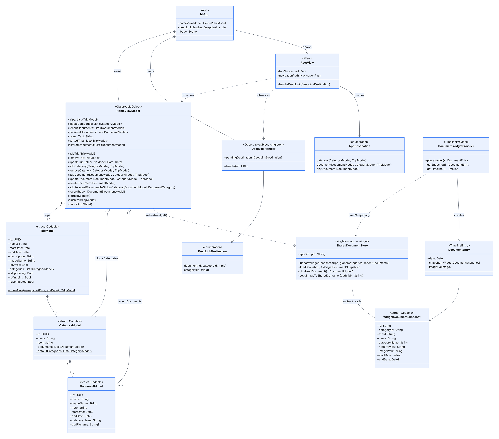
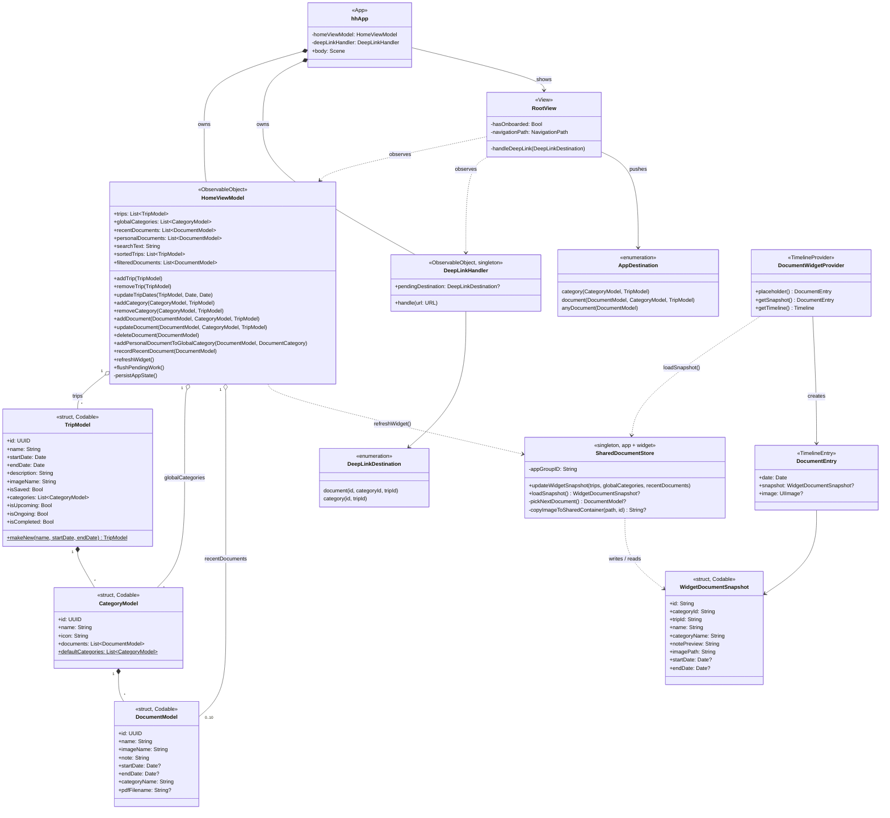
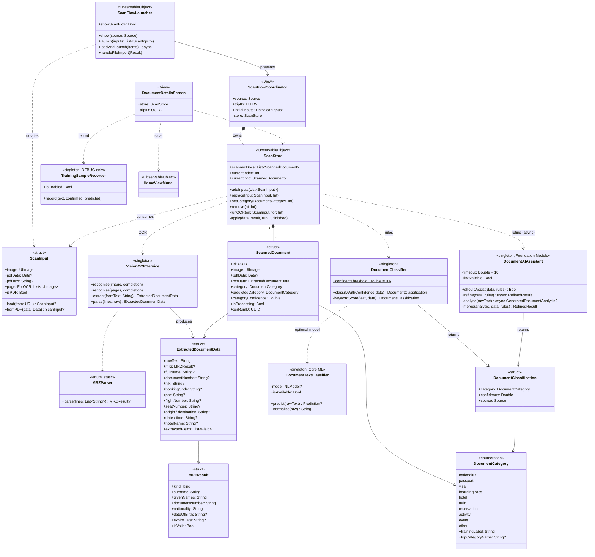
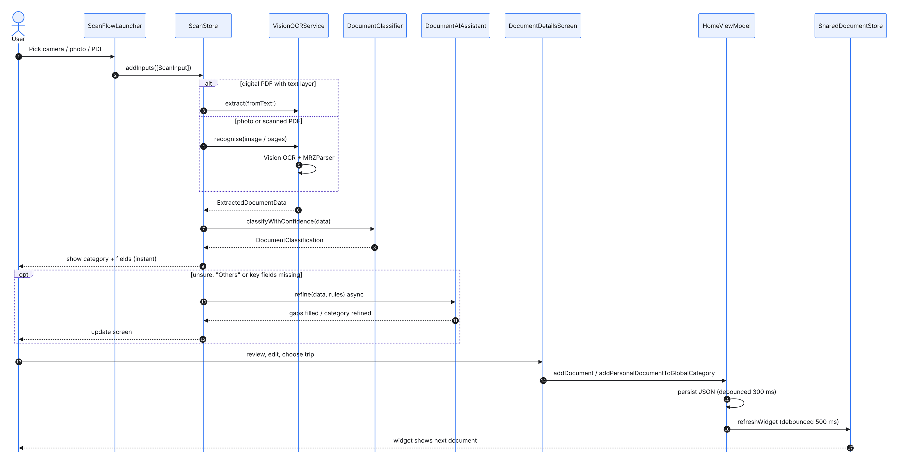
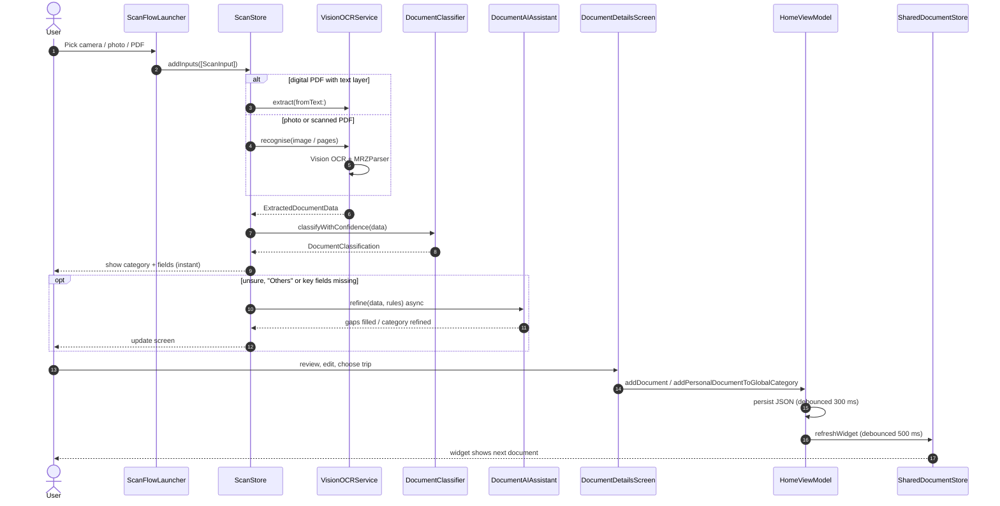

# SwiftTrip UML Diagrams

UML views of SwiftTrip, drawn from the current code. For product-level diagrams (use cases, goals and strategy, UI navigation, user journey), see [PRODUCT.md](PRODUCT.md). For the narrative architecture, see [ARCHITECTURE.md](ARCHITECTURE.md).

| Diagram | Shows |
|---|---|
| [1. Class diagram: domain, state and widget](#1-class-diagram-domain-state-and-widget) | Data model, `HomeViewModel`, deep links, widget extension |
| [2. Class diagram: scan pipeline](#2-class-diagram-scan-pipeline) | Capture, OCR, MRZ, classification, Foundation Models assist |
| [3. Sequence diagram: scanning a document](#3-sequence-diagram-scanning-a-document) | What happens from picking a photo or PDF to the widget update |

Each diagram is available as a PNG in [`docs/uml/`](uml/) and as Mermaid source (`.mmd`). GitHub draws the Mermaid blocks below directly, and you can edit them at [mermaid.live](https://mermaid.live).

### Notation

| Symbol | Meaning |
|---|---|
| `+` / `-` | public / private member |
| underlined or `$` | static member |
| `«struct»`, `«enumeration»`, `«ObservableObject»`… | stereotype: the Swift kind or protocol |
| ◆── (filled diamond) | **composition**: the owner creates and owns the part (`TripModel` → `CategoryModel`) |
| ◇── (hollow diamond) | **aggregation**: holds a collection (`HomeViewModel` → trips) |
| ──▶ (solid arrow) | **association**: holds a reference / returns |
| ┈┈▶ (dashed arrow) | **dependency**: calls or uses |
| `1`, `*`, `0..10` | multiplicity |

Swift arrays are written `List~T~`, and optionals keep Swift's `?`.

---

## 1. Class diagram: domain, state and widget

**How to read it**
- `hhApp` owns the two long-lived objects: `HomeViewModel` (all app data) and `DeepLinkHandler`.
- The data is a tree: **`TripModel` ◆ `CategoryModel` ◆ `DocumentModel`**. Personal Essentials are `CategoryModel`s held directly by the view model (`globalCategories`). `recentDocuments` keeps up to 10 references.
- `HomeViewModel.refreshWidget()` calls **`SharedDocumentStore`**. It is compiled into both the app and the widget, and it writes a `WidgetDocumentSnapshot` to the App Group. The widget's `DocumentWidgetProvider` reads it back into a `DocumentEntry`.
- A widget tap opens `hh://document/…`. `DeepLinkHandler` turns it into a `DeepLinkDestination`, and `RootView` pushes the matching `AppDestination`.

Mermaid source

---

## 2. Class diagram: scan pipeline

**How to read it**
- `ScanFlowLauncher` turns the user's pick into `ScanInput`s and presents `ScanFlowCoordinator`, which **owns** a `ScanStore`.
- `ScanStore` holds the batch of `ScannedDocument`s. For each one it calls:
  - **`VisionOCRService`** (with **`MRZParser`**), which produces `ExtractedDocumentData`
  - **`DocumentClassifier`**, which may consult the optional Core ML **`DocumentTextClassifier`**
  - **`DocumentAIAssistant`** (Foundation Models), only when the result is unsure
- Both classifiers return a **`DocumentClassification`**: a `DocumentCategory`, a confidence, and the source of the answer.
- `DocumentDetailsScreen` saves the confirmed document through `HomeViewModel`. In DEBUG builds it also logs a training sample with `TrainingSampleRecorder`.

Mermaid source

---

## 3. Sequence diagram: scanning a document

**How to read it**
- **Steps 3–5:** a digital PDF is read from its text layer. A photo or scanned PDF goes through Vision OCR and MRZ parsing.
- **Steps 7–9:** the rule-based result is shown **immediately**.
- **Steps 10–12 (optional):** Foundation Models refines the result in the background, only when the rules are unsure, returned "Others", or are missing key fields.
- **Steps 13–17:** saving updates `HomeViewModel`, which writes JSON after 300 ms and refreshes the widget after 500 ms.

Mermaid source

---

## Updating the diagrams

1. Edit the `.mmd` file in `docs/uml/` and the matching block above.
2. Re-export the PNG:
   - **Quickest:** paste the source into [mermaid.live](https://mermaid.live) and choose **Actions ▸ PNG**.
   - **Command line:** `npx -p @mermaid-js/mermaid-cli mmdc -i docs/uml/class-scan.mmd -o docs/uml/class-scan.png -s 2 -b white`
